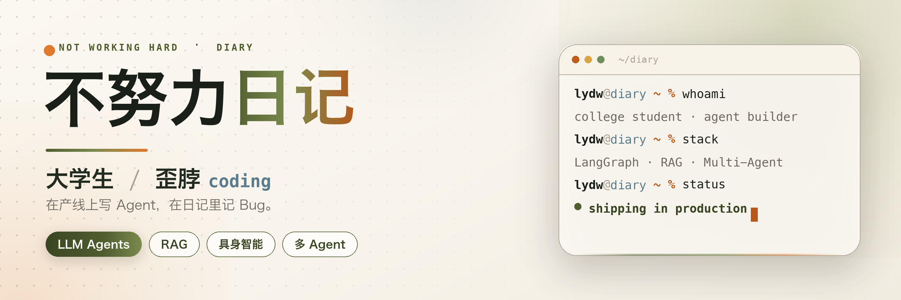

  

### 你好，我是不努力日记 👋

大学生 · 歪脖 coding　|　在产线上写 Agent，在日记里记 Bug

- 🔭 **现在在做**：生产级 LLM Agent / RAG / 多智能体编排
- 🏭 **两段产线实战**：🤖 具身智能银行网点机器人（广电运通 GRG）× 🚗 商用车主动安全多 Agent 平台（魔视智能）
- 🧠 **正在做**：LocalDev Agent · 三层上下文压缩 · Human-in-the-Loop
- 📄 **一篇论文**：Diff-Ensemble，ACM CCF-A 在审

我关心的是：**Agent 怎么在真实业务里稳定地跑起来**——上下文怎么压缩、工具怎么评测、流程怎么恢复、人在什么位置介入。

> 不做 Demo 级 Agent，做能在产线上跑的 Agent。

---

## 🚀 精选项目

<table>
<tr>
<td width="50%" valign="top">

<h3>🤖 robot-agent-runtime-docs</h3>

具身智能银行网点机器人的「大脑」：分层 Agent Runtime、Robot State 状态机与可回放的评测框架。

<a href="https://github.com/liuyuelove/robot-agent-runtime-docs"><b>查看项目 →</b></a>

</td>
<td width="50%" valign="top">

<h3>🚗 aftermarket-perception-agent</h3>

商用车后装算法迭代 Agent：把「数据下载 → 标注 → 训练 → 评估」串成一条可人工确认的自动化工作流。

<a href="https://github.com/liuyuelove/aftermarket-perception-agent"><b>查看项目 →</b></a>

</td>
</tr>
</table>

<h3>🧩 LocalDev Agent　</h3>

> 面向长任务的多 Agent 协作框架：三层上下文压缩、DAG 持久化任务、异步协作协议与 Working/Idle 状态机，支持全链路可观测与断电恢复。
>
> **一句话：Agent 跑得久，也跑得回来。**

<a href="https://github.com/liuyuelove/localdev_agent"><b>查看项目 →</b></a>　如果对你有帮助，欢迎 Star ⭐

---

## 🏭 两段产线实战

<table>
<tr>
<td width="50%" valign="top">

<h3>🤖 具身智能银行网点机器人</h3>

<b>广电运通 GRG</b> · 算法开发 
2026.06 – 2026.10

<ul>
<li>从 0 到 1 设计分层 Agent 架构：生命周期 / LangGraph 编排 / 业务规则 / Tool / Adapter / Prompt 解耦</li>
<li>打通人脸 · ASR · 数字人 · 机器人动作的多模态链路，支撑迎宾、咨询、办理、巡检闭环</li>
<li>自研 Agent 测评框架：回放驱动、工具调用参数级匹配、失败分类与多模型对比</li>
</ul>

</td>
<td width="50%" valign="top">

<h3>🚗 商用车主动安全多 Agent 平台</h3>

<b>魔视智能</b> · 大模型应用开发 
2026.03 – 2026.06

<ul>
<li>基于 LangGraph StateGraph 构建多 Agent 工作流，贯通数据下载 → 标注 → 训练 → 评估全流程</li>
<li>集成 Human-in-the-Loop 人工确认，保障行车安全场景下的关键决策可控</li>
<li>二次开发 Motovis-RAG：20+ 文档格式、Elasticsearch 向量检索 + Rerank 双阶段召回、OpenAI 兼容 API</li>
</ul>

</td>
</tr>
</table>

---

## 🧰 技术栈

**Agent & LLM**

**检索 & 数据**

**模型 & 训练**

`Transformer` `MoE` `GQA` `KV Cache` `LoRA / QLoRA` `SFT` `DPO` `模型量化` `推理加速` `云边端部署`

**具身 & 多模态**

---

## 📄 论文

**Diff-Ensemble：基于扩散模型的迁移性与隐蔽性对抗攻击研究**  
Under Review · ACM（CCF-A）

> 提出基于潜变量扩散模型 LDM 的生成式攻击框架，将对抗生成重构为有引导的降噪过程，干预 DDIM 采样轨迹并结合注意力正则化。ImageNet 黑盒攻击 SOTA：11 种目标模型平均攻击成功率 **88.77%**，FID 50.81，较 DiffAttack / AWT 等基线 ASR 相对提升 **24.7%–39.7%**。

---

## 📊 GitHub

  
  

---

<b>🎓 教育 &amp; 其他经历</b>

 

- 🎓 **华中师范大学** · 计算机技术硕士（2024.09 – 2027.06）
- 🎓 **武汉纺织大学** · 信息与计算科学（2020.09 – 2024.06）
- 🏆 研究生数学建模大赛国家三等奖 · 大创 A 级项目（基于 Apollo 无人驾驶技术服务系统）
- 🧩 **飞书智能项目管理引擎**（独立开发）：Plugin + Tenant Access Token 双令牌权限体系，4.1W+ 工作项 15 并发拉取与分页降级；Feishu-Project AgentSkill 将飞书项目 API 与高阶查询封装为自然语言指令，让通用 LLM 无需微调即可编排 API 调用链路。

---

## 🌐 找到我

---

不努力是假的，写 Agent 是真的。 · 如果这些项目对你有帮助，欢迎 Star ⭐

